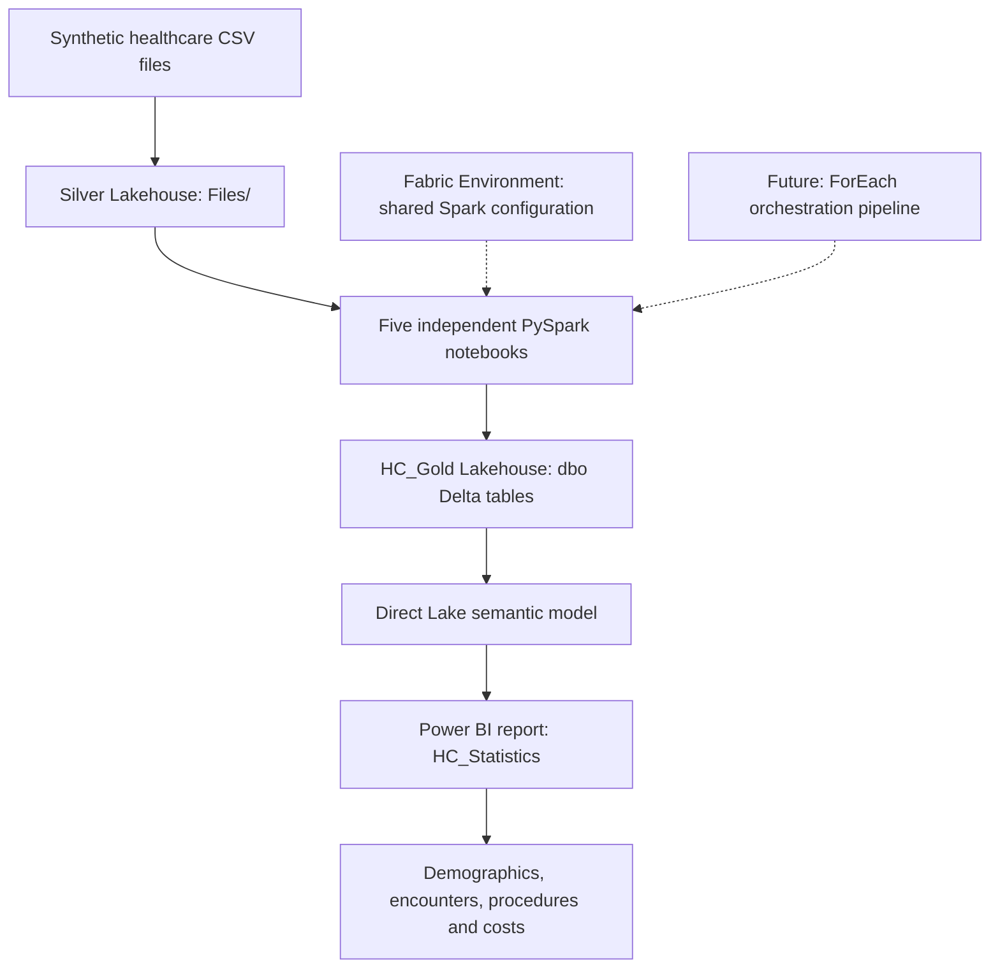

# Healthcare Analytics with Microsoft Fabric

An end-to-end data engineering and analytics project built with **Microsoft Fabric, PySpark, Delta Lake, Direct Lake, and Power BI**. It transforms synthetic healthcare records into curated Delta tables and uses a semantic model and interactive Power BI report to explore patient demographics and hospital activity.

## Project Overview

The project brings together five healthcare datasets: patients, encounters, procedures, insurance payers, and organizations. Each dataset is processed in a separate PySpark notebook, written to a Gold Lakehouse, and made available for reporting through a Direct Lake semantic model.

**Highlights**

- Silver-to-Gold Lakehouse architecture in Microsoft Fabric.
- Five separate PySpark notebooks for reusable transformations.
- Curated Delta tables registered under the `dbo` schema.
- Shared Fabric Environment configuration for the Gold Lakehouse path.
- Direct Lake semantic model and Power BI report.

## Architecture



The current workflow uses **manual notebook execution**. The notebooks read CSV files from the Silver Lakehouse and write the transformed datasets to registered Delta tables under the `dbo` schema of `HC_Gold`. A shared Fabric Environment stores the reusable Gold Lakehouse path configuration. A future Fabric Data Pipeline can execute the same notebooks automatically.

## Technologies Used

| Technology | Purpose |
| --- | --- |
| Microsoft Fabric | Integrated workspace for data engineering and analytics |
| OneLake and Lakehouses | Store source files and curated Delta tables |
| PySpark | Clean and transform healthcare data |
| Delta Lake | Store analytical tables in Delta format |
| Fabric Environment | Share Spark configuration across notebooks |
| Direct Lake | Connect the Power BI semantic model to curated data |
| Power BI | Build interactive analytical reports |

## Dataset

The project uses the synthetic [Hospital Patient Records dataset from Maven Analytics](https://mavenanalytics.io/data-playground/hospital-patient-records), based on synthetic healthcare data generated by the Synthea ecosystem.

| File | Records | Description |
| --- | ---: | --- |
| `patients.csv` | 974 | Patient demographics and personal attributes |
| `encounters.csv` | 27,891 | Hospital encounters, care information, and costs |
| `procedures.csv` | 47,701 | Medical procedures, timestamps, and costs |
| `payers.csv` | 10 | Insurance providers |
| `organizations.csv` | 1 | Healthcare organization |

The `dataset/` folder also includes the data dictionary and source citation. Counts shown are for the original source files.

## Data Processing

### 1. Silver Lakehouse

The five source CSVs are loaded into the Silver Lakehouse's `Files/` area. Each transformation notebook reads its corresponding file. For example:

```python
df_patients = spark.read.csv("Files/patients.csv", header=True)
```

### 2. PySpark Transformation Notebooks

| Notebook | Main transformations |
| --- | --- |
| `DIM_Patients` | Convert date fields; derive age, age groups, deceased flag, and full name; prepare geographic coordinates |
| `DIM_Payers` | Clean payer names and cities; standardize states; group insurance providers |
| `DIM_Organizations` | Standardize organization and location fields; prepare coordinates |
| `DIM_Procedures` | Convert procedure timestamps; calculate durations; prepare costs and procedure categories |
| `FACT_Encounters` | Calculate admitted days and identify patients' first encounters using window functions |

### 3. Shared Fabric Environment

A reusable Gold Lakehouse path is configured as a Spark Environment property:

```text
spark.executorEnv.HC_Goldpath
```

Notebooks attached to the same published Fabric Environment can retrieve the value with:

```python
path = spark.conf.get("spark.executorEnv.HC_Goldpath")
```

This centralizes the path configuration rather than repeating the complete OneLake address throughout the notebooks. The final Gold writes use fully qualified table names to register tables in the `dbo` schema.

### 4. Gold Lakehouse

The processed data is saved as Delta tables in **`Healthcare_DE_Project` → `HC_Gold` → `dbo`**.

| Gold Delta Table | Contents |
| --- | --- |
| `DIM_Patients` | Patient demographics and derived attributes |
| `DIM_Payers` | Cleaned insurance payer details |
| `DIM_Organizations` | Organization and geographic details |
| `DIM_Procedures` | Procedure-level information and calculated durations |
| `FACT_Encounters` | Hospital encounters and encounter-level metrics |

The notebooks use `saveAsTable()` to create catalog-registered Delta tables. For example:

```python
(
    df_patients_transformed.write
    .format("delta")
    .mode("overwrite")
    .option("overwriteSchema", "true")
    .saveAsTable("Healthcare_DE_Project.HC_Gold.dbo.DIM_Patients")
)
```

## Power BI Semantic Model

The semantic model brings the curated healthcare tables together for reporting. It provides the analytical layer used by the Power BI report, including table relationships and business calculations.

## Power BI Dashboard

The **HC_Statistics** Power BI report, titled **Mortality Analytics**, presents healthcare insights through visuals covering:

- Patient distribution by gender and race.
- Age and age-group demographics.
- Geographic distribution of patients.
- Recorded deceased indicators.

The report is included in this repository as **`HC_Statistics.pbix`**. Its connection to the online Fabric semantic model may require access to the corresponding Fabric workspace and dataset.

## Repository Structure

```text
Healthcare-Fabric-Project/
├── dataset/                # Source CSV files, data dictionary, citation
├── notebooks/              # Five PySpark transformation notebooks
├── HC_Statistics.pbix      # Power BI report
├── Semantic_Model.png      # Semantic model screenshot
└── README.md               # Project documentation
```

## How to Reproduce

1. Create a Microsoft Fabric workspace and set up Silver and Gold Lakehouses.
2. Upload the five CSV files to the Silver Lakehouse `Files/` directory.
3. Import the transformation notebooks and attach the Silver Lakehouse as their default Lakehouse.
4. Attach the shared Fabric Environment and configure `spark.executorEnv.HC_Goldpath`.
5. Update the workspace and Lakehouse references in notebook write statements as required.
6. Run the five notebooks to create the Delta tables in the Gold Lakehouse `dbo` schema.
7. Create a Direct Lake semantic model using the Gold tables and configure the table relationships.
8. Open the Power BI report and connect it to the appropriate semantic model.

## Data Source and Attribution

- **Dataset:** [Maven Analytics — Hospital Patient Records](https://mavenanalytics.io/data-playground/hospital-patient-records)
- **Original synthetic-data framework:** Synthea / SyntheticMass
- **Academic citation:** Included in `dataset/citation.txt`

This project uses synthetic data for learning and analytics demonstrations. It is not intended for clinical decision-making.
