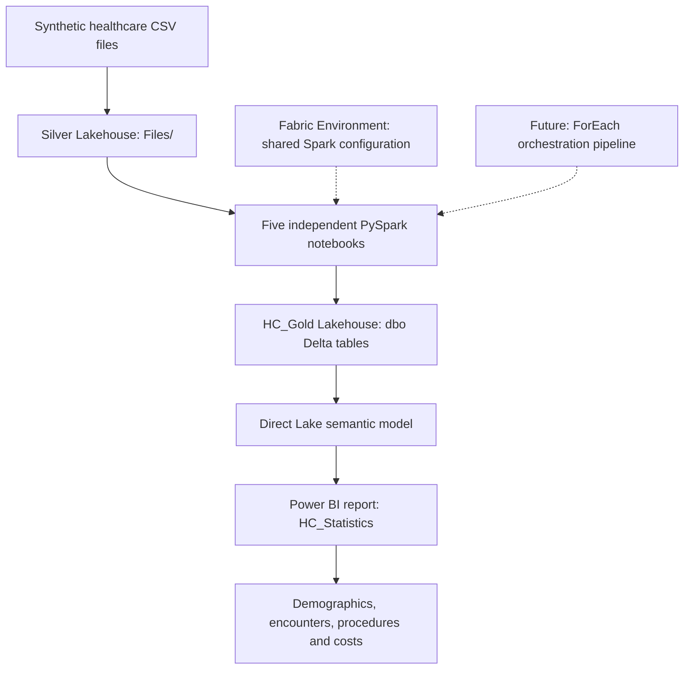

# Healthcare Analytics with Microsoft Fabric

An end-to-end healthcare data engineering and analytics project using **Microsoft Fabric, PySpark, Delta Lake, Direct Lake, and Power BI**. Synthetic hospital records are cleaned in separate transformation notebooks, stored as Delta tables in a Gold Lakehouse, and analyzed through a Power BI semantic model and report.

> **Project status:** Source datasets, transformation notebooks, a Gold Lakehouse, a semantic model, and a Power BI report have been created. Notebook orchestration with a ForEach pipeline is a **planned enhancement**, not part of the current execution flow.

## Architecture



The current workflow uses **manual notebook execution**. The notebooks read CSV files from the Silver Lakehouse and write the transformed datasets to registered Delta tables under the `dbo` schema of `HC_Gold`. A shared Fabric Environment stores the reusable Gold Lakehouse path configuration. A future Fabric Data Pipeline can execute the same notebooks automatically.

## Project objectives

- Prepare patient, hospital encounter, procedure, payer, and organization records for analysis.
- Build reusable transformations in one PySpark notebook per dataset.
- Store curated data as Delta tables under a schema-enabled Gold Lakehouse.
- Build relationships and business measures in a Power BI semantic model.
- Explore patient demographics and hospital activity in an interactive report.

## Technology stack

| Technology | Role |
| --- | --- |
| Microsoft Fabric | End-to-end development workspace and analytics platform |
| OneLake / Lakehouses | Storage for source CSVs and curated Delta tables |
| PySpark notebooks | Cleaning, type conversions, and derived attributes |
| Delta Lake | Managed analytical table format |
| Fabric Environment | Reusable Spark configuration, including the Gold Lakehouse setting |
| Power BI semantic model / Direct Lake | Business modeling and access to Gold data |
| Power BI | Interactive reports and visuals |

## Source data

The project uses synthetic **Hospital Patient Records** data from [Maven Analytics Data Playground](https://mavenanalytics.io/data-playground/hospital-patient-records). The dataset derives from the Synthea/SyntheticMass synthetic health record ecosystem; see the accompanying `citation.txt` for its academic citation.

| Source file | Rows | Contents |
| --- | ---: | --- |
| `patients.csv` | 974 | Demographics, birth/death dates, and location |
| `encounters.csv` | 27,891 | Healthcare encounters, payer details, and costs |
| `procedures.csv` | 47,701 | Procedures, encounter keys, recorded costs, and timestamps |
| `payers.csv` | 10 | Insurance payer reference data |
| `organizations.csv` | 1 | Healthcare organization reference data |

These are **source-file counts**. Confirm Gold row counts after rerunning transformations. The repository also includes `data_dictionary.csv` and `citation.txt`. Check the dataset provider's terms before redistributing source files; third-party data is not automatically covered by this repository's code license.

## Processing workflow

### 1. Silver Lakehouse: source landing

CSV files are uploaded into the Silver Lakehouse `Files/` area. Each notebook has the Silver Lakehouse attached as its default Lakehouse and reads its own file, for example:

```python
df_patients = spark.read.csv("Files/patients.csv", header=True)
```

### 2. Independent transformation notebooks

| Notebook / Gold output | Main transformations |
| --- | --- |
| `DIM_Patients` | Convert birth/death dates; calculate age and age groups; create deceased flag and full name; cast coordinates |
| `DIM_Payers` | Trim names; standardize state; create simplified payer groups; preserve ZIP and phone as text |
| `DIM_Organizations` | Clean hospital and city; standardize state; create location label; cast coordinates |
| `DIM_Procedures` | Parse procedure timestamps; derive date and duration; cast base cost; create illustrative procedure categories |
| `FACT_Encounters` | Calculate admitted days and identify first visits using patient-level window logic |

The payer and procedure categories are **simplified project-specific analytical groupings**, not authoritative insurance or clinical classifications. Patient age for living patients is time-dependent because it uses the notebook execution date.

### Shared Fabric Environment configuration

To avoid hard-coding a different OneLake location in every notebook, the project defines a **shared Gold Lakehouse path setting** in a Fabric Environment. The configured Spark property is:

```text
spark.executorEnv.HC_Goldpath
```

Notebooks attached to the same **published** Fabric Environment can retrieve the configured value with:

```python
path = spark.conf.get("spark.executorEnv.HC_Goldpath")
```

The configuration points to the root of the Gold Lakehouse (`HC_Gold`). Each notebook still runs in its own session, but reads the same published setting when the Environment is attached. When the Environment configuration changes, publish it and start a new Spark session before validating it.

**Current implementation:** The production-style Gold writes use fully qualified `saveAsTable()` names under `Healthcare_DE_Project.HC_Gold.dbo`, rather than building the destination using the path variable. The environment setting is retained as a reusable configuration for path-based operations and future notebook/pipeline work. It does not automatically change the destination of hard-coded `saveAsTable()` calls. Update those fully qualified names if you move the project to a new workspace. Do not store secrets in Environment properties committed to a public repository.

### 3. Gold Lakehouse: registered Delta tables

The destination is **`Healthcare_DE_Project` → `HC_Gold` → `dbo`**. The notebook output tables are:

- `dbo.DIM_Patients`
- `dbo.DIM_Payers`
- `dbo.DIM_Organizations`
- `dbo.DIM_Procedures`
- `dbo.FACT_Encounters`

A table is written using the catalog-aware approach illustrated below:

```python
(
    df_patients_transformed.write
    .format("delta")
    .mode("overwrite")
    .option("overwriteSchema", "true")
    .saveAsTable("Healthcare_DE_Project.HC_Gold.dbo.DIM_Patients")
)
```

**Caution:** `overwrite` replaces the table's contents, and `overwriteSchema` allows replacing its schema. Review target names before running. An earlier path-based write to `Tables/FACT_Encounters` caused a Direct Lake table-access issue; the table was recreated using schema-aware registration.

## Semantic model

A Direct Lake semantic model connects the Gold tables to Power BI. The intended relationships for analysis are:

| One-side table and key | Many-side table and key | Cardinality |
| --- | --- | --- |
| `DIM_Patients[Id]` | `FACT_Encounters[PATIENT]` | 1:* |
| `DIM_Payers[Id]` | `FACT_Encounters[PAYER]` | 1:* |
| `DIM_Organizations[Id]` | `FACT_Encounters[ORGANIZATION]` | 1:* |
| `FACT_Encounters[Id]` | `DIM_Procedures[ENCOUNTER]` | 1:* |

**Model validation required:** The sample model documentation shows a relationship between `DIM_Procedures[CODE]` and `FACT_Encounters[CODE]`. These represent clinical codes, not an encounter-level relationship. Check the *actual exported model* and consider using `DIM_Procedures[ENCOUNTER]` → `FACT_Encounters[Id]` for encounter-based analysis. `DIM_Procedures` contains transaction-level records, so despite its name it behaves as a procedure-detail fact table.

Do not claim the table relationships above are already implemented until you verify them in Power BI's Model view or the exported semantic model definition.

## Power BI report

The project includes the `HC_Statistics` Power BI report, titled **Mortality Analytics** in the supplied reference. It explores:

- Patient distribution by gender and race.
- Age and age-group patterns.
- Geographic distribution.
- Recorded deceased indicators.

For a report built on a Direct Lake semantic model, the downloadable `.pbix` is typically a **live-connected report**: it contains report pages and visuals, but not a copy of the Lakehouse data or the Direct Lake semantic model. The live connection requires access to the published model. Export the separate model definition as a **Power BI Project (PBIP) with TMDL** and add a report preview screenshot to `docs/screenshots/` so visitors can see the dashboard without opening Power BI.

> These records are synthetic. The deceased indicator is not by itself a population mortality rate; any rate requires a justified denominator and time period. The report is for educational analytics, not clinical decision-making.

## Repository layout

The currently uploaded source-data and notebook folders are the starting point. The remaining folders below are **recommended additions**, not necessarily present yet.

```text
healthcare-fabric-data-engineering/
├── dataset/                     # Existing: five CSVs, dictionary, citation
├── notebooks/                   # Existing: five transformation notebooks
├── powerbi/                     # Add: semantic model definition and report file
├── docs/
│   ├── screenshots/             # Add: report and model screenshots
│   ├── data-model.md            # Add: keys, relationships, and grain
│   └── validation.md            # Add: row counts and quality checks
├── README.md
├── .gitignore                   # Add: exclude caches, credentials, outputs
└── LICENSE                      # Add if you choose a license for original code
```

## Reproduce the project in Fabric

1. Create or open a Fabric-enabled workspace. This project uses `Healthcare_DE_Project`.
2. Create the Silver source Lakehouse and schema-enabled Gold Lakehouse (`HC_Gold`).
3. Upload the five CSV files to the Silver Lakehouse's `Files/` root.
4. Import the five notebooks, set the Silver Lakehouse as each notebook's default, and attach the shared Fabric Environment.
5. Configure and publish the Gold Lakehouse path Spark property `spark.executorEnv.HC_Goldpath` in the shared Fabric Environment. Attach that Environment to each notebook; validate with `spark.conf.get("spark.executorEnv.HC_Goldpath")` in a new Spark session.
6. Review fully qualified table destinations in the notebook write cells. Update workspace and Lakehouse references if deploying elsewhere.
7. Execute the notebook cells to create and register the five `dbo` Delta tables in Gold.
8. Validate counts, data types, uniqueness of dimension keys, and foreign-key matching.
9. Create or rebind a Direct Lake semantic model and verify relationships against the model definition.
10. Open the Power BI report, confirm its semantic model connection, and test filters and measures.

Fabric item IDs, permissions, capacity assignments, and connection bindings may need adjustment when reproducing the project in another workspace.

## Validation and limitations

- Verify row counts against the source-file totals above.
- Check uniqueness and non-null values for `Id` on the one side of relationships.
- Check unmatched `PATIENT`, `PAYER`, `ORGANIZATION`, and `ENCOUNTER` foreign keys.
- Inspect NULL or invalid date/cost conversions before using duration or financial measures.
- Check that the Gold tables are registered and readable through both Spark and the SQL Analytics Endpoint.
- Verify the report's actual DAX measures and relationship directions before presenting analytical conclusions.
- Notebook execution is manual; the proposed ForEach orchestration pipeline is not yet implemented as an operational data workflow.
- A fresh deployment into another Fabric workspace has not been confirmed.

## Next steps

- Export and commit the **semantic model definition** (ideally TMDL) and the **Power BI report** (`.pbix` or a Power BI Project, where supported).
- Add screenshots of the dashboard and relationship diagram.
- Document validated DAX measures and data-quality results.
- Add a Fabric pipeline that executes the transformation notebooks, then document scheduling and monitoring.
- Optionally add deployment/version-control configuration for Dev/Test/Prod after validating it.

## Attribution, security, and license

- **Dataset:** [Maven Analytics, Hospital Patient Records](https://mavenanalytics.io/data-playground/hospital-patient-records).
- **Academic citation:** See `dataset/citation.txt` and the original Synthea citation included with the download.
- **Security:** Never commit secrets, access tokens, personal credentials, real patient data, or notebook outputs containing sensitive values. Review workspace IDs and data-source connection details before publishing.
- **License:** `LICENSE` uses the MIT License for **original notebook code and project documentation**. Replace the copyright-holder placeholder with your own name or GitHub username before publishing. Source datasets and Microsoft/third-party assets retain their own licensing terms.
